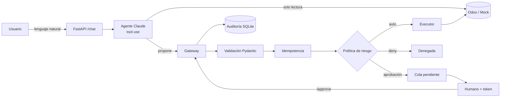

# agente-erp-seguro

Agente de IA (Claude) que opera sobre **Odoo** (CRM, ventas y compras) con una premisa de diseño:
**el modelo nunca ejecuta nada; solo propone**. Cada acción pasa por validación estricta, política de
riesgo, idempotencia, aprobación humana y auditoría antes de tocar el ERP.

> Proyecto personal de demostración. Incluye un ERP simulado (`MockOdoo`) para ejecutarlo sin infraestructura
> y un backend real para Odoo por API externa.

## El problema

Un agente que puede crear pedidos o confirmar compras es útil… y peligroso. Un malentendido del modelo,
un dato ambiguo o una inyección de prompt pueden emitir un pedido equivocado o duplicado.
Este proyecto muestra cómo acotar ese riesgo con ingeniería, no con confianza en el prompt.

## Arquitectura



## Decisiones de seguridad

| Riesgo | Control | Dónde |
|---|---|---|
| El LLM ejecuta algo directamente | No existe ninguna herramienta de ejecución; solo `propose_*` y búsquedas de lectura | `agent.py` |
| Datos inventados o fuera de rango | Esquemas Pydantic estrictos (`extra=forbid`, rangos, email) | `actions.py` |
| Importes peligrosos | Límite automático por tipo + **límite duro** que deniega | `policy.py` |
| Confirmar pedidos sin control | `confirm_order` siempre requiere aprobación humana | `policy.py` |
| Duplicados (reintentos, doble clic) | Clave de idempotencia (hash) + índice único parcial en BD | `actions.py`, `store.py` |
| Doble aprobación / carrera | Transición de estado atómica `pending → executing` | `store.py` |
| Cliente o producto ambiguo | Se falla en vez de adivinar entre candidatos | `executor.py` |
| Cambió el pedido entre propuesta y aprobación | Se revalida la política al aprobar | `gateway.py` |
| Inyección de prompt vía datos del ERP | Prompt de sistema + el modelo no tiene capacidad de ejecutar aunque obedezca | `agent.py` |
| Aprobador sin autenticar | Token obligatorio; sin `APPROVAL_TOKEN` las aprobaciones quedan **deshabilitadas** | `main.py` |
| Probar sin riesgo | `DRY_RUN=true`: nada se escribe en el ERP | `gateway.py` |
| Trazabilidad | Log de auditoría de cada propuesta, decisión y ejecución | `store.py` |

La política por defecto: crear una oportunidad y borradores pequeños es automático; compras sobre 500 €,
ventas sobre 1.000 € y cualquier confirmación piden aprobación; sobre 50.000 € se deniega. Todo configurable.

## Puesta en marcha

```bash
git clone https://github.com/Pipuribe/agente-erp-seguro && cd agente-erp-seguro
python -m venv .venv && source .venv/bin/activate
pip install -r requirements-dev.txt
cp .env.example .env        # añade tu ANTHROPIC_API_KEY y un APPROVAL_TOKEN
pytest -q                   # 36 tests, no necesitan API key ni Odoo

set -a && source .env && set +a
uvicorn app.main:create_app --factory --reload
```

### Demo con el ERP simulado

```bash
# 1) Pedir algo en lenguaje natural
curl -s localhost:8000/chat -H 'content-type: application/json' \
  -d '{"message":"Hazle un presupuesto a Solaris de 10 paneles solares de 400W a 250 EUR"}'
# -> propuesta en estado "pending" (2.500 EUR > limite automatico)

# 2) Ver pendientes
curl -s 'localhost:8000/actions?status=pending'

# 3) Aprobar como humano
curl -s -X POST localhost:8000/actions/1/approve \
  -H "X-Approval-Token: $APPROVAL_TOKEN" -H 'content-type: application/json' \
  -d '{"approver":"ana"}'

# 4) Auditoría
curl -s localhost:8000/audit
```

Prueba también: *"presupuesto para Acme"* (el cliente es ambiguo: el agente debe preguntar) o
*"compra 10.000 tornillos M8 a 100 EUR"* (supera el límite duro: denegada).

### Con Odoo real

```bash
docker compose up -d        # Odoo 18 + Postgres en localhost:8069
```
Crea la base de datos `odoo`, instala **CRM, Ventas y Compras**, genera una API key en
*Preferencias → Seguridad de la cuenta* y configura `ERP_BACKEND=odoo` + `ODOO_*` en `.env`.
Empieza con `DRY_RUN=true`.

> Nota: el backend usa XML-RPC. La documentación de Odoo indica que se retirará en una versión futura a favor
> de la API JSON-2; el contrato `ERPBackend` (`app/odoo/base.py`) permite añadir ese cliente sin tocar el resto.

## Tests

36 tests, incluyendo escenarios adversariales: un LLM "manipulado" que intenta confirmar pedidos sin aprobación,
exceder el límite duro, usar herramientas inexistentes o enviar cantidades negativas. En todos los casos
el ERP queda intacto.

## Limitaciones conocidas y siguientes pasos

- La autenticación de aprobadores es un token compartido; en producción: SSO/roles y doble aprobación por importe.
- Sin límite de frecuencia por usuario ni memoria de conversación entre llamadas a `/chat`.
- Falta el cliente JSON-2 de Odoo y probar contra más módulos (contactos nuevos, facturas, remesas SEPA).
- Siguiente: notificación de aprobaciones por Slack/email y una pequeña UI de cola.

## Estructura

```
app/
  actions.py     esquemas de acciones + idempotencia
  policy.py      política de riesgo (función pura)
  gateway.py     propose / approve / reject
  executor.py    única capa que escribe en el ERP
  agent.py       Claude + tool use
  store.py       SQLite: cola, idempotencia, auditoría
  main.py        API FastAPI
  odoo/          contrato, mock y cliente XML-RPC
tests/           políticas, gateway, agente adversarial, API
```
